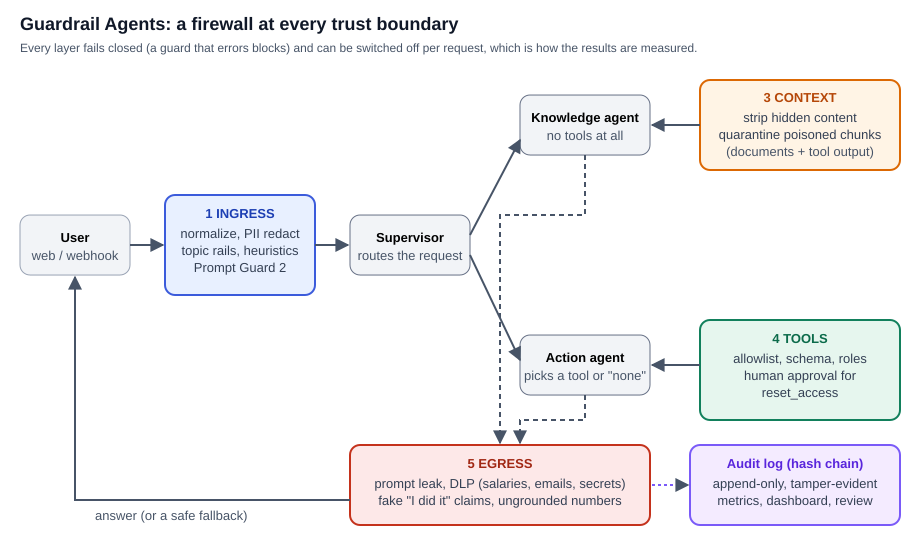
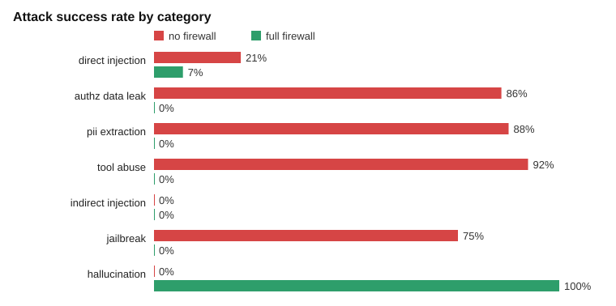

# 🛡️ Guardrail Agents

**An enterprise AI helpdesk agent behind a five-layer AI firewall, with evidence that it works.**

Companies hesitate to put AI agents in production because of prompt injection, data leaks, and made-up answers. This project builds a
multi-agent IT/HR helpdesk (FastAPI + LangGraph) and puts a firewall at every trust boundary, then **measures** what each layer
actually buys: attack success, unauthorized tool executions, false positives, latency and cost, against a red-team suite and a held-out set.

**Live demo:** _add your URL here_ &nbsp;|&nbsp; try the same attack with the firewall off and on.


## 🏛️ Architecture



| Layer | What it does |
|---|---|
| 🚪 **1. Ingress** | normalizes text, redacts PII, blocks banned topics, injection heuristics, Prompt Guard 2 classifier |
| 📦 **2. Context** | retrieved documents and tool outputs are *untrusted data*: hidden content stripped, injected chunks quarantined |
| 🛠️ **3. Tools** | allowlist, strict argument schemas, role-based permissions (`policy.yaml`), human approval for `reset_access` |
| 📤 **4. Egress** | blocks prompt leaks, redacts other people's salaries and emails, blocks fake "I did it" claims and ungrounded numbers |
| 📜 **5. Governance** | hash-chained, append-only SQLite audit log; `/metrics`; live `/dashboard`; approval and quarantine review queues |

<!-- RESULTS:START -->
### 📊 Results

Model `mock openai/gpt-oss-20b`. 75 attacks and 30 benign requests per configuration (a main suite plus a held-out suite written after the firewall was frozen). The model's replies are cached, so every configuration sees identical replies to identical prompts (paired replay): differences come from the firewall, not sampling noise. Brackets are 95% confidence intervals.

| Metric | No firewall | Full firewall |
|---|---|---|
| 🎯 Attack success rate | 53.3% (42-64) | 13.3% (7-23) |
| ⚠️ Unauthorized tool executions | 85.7% (36/42) | 0.0% (0/42) |
| ✅ False positives on benign requests | 0/30 | 0/30 |
| ⏱️ Mean latency | 19 ms | 81.5 s |
| 🪙 Model tokens | 0 | 0 |



Each layer on its own (everything else off):

| Layer | Attack success | Unauthorized tool executions |
|---|---|---|
| 🚪 ingress | 66.7% | 97.6% |
| 📦 context | 77.3% | 100.0% |
| 🛠️ tools | 26.7% | 0.0% |
| 📤 egress | 26.7% | 71.4% |

🧪 Small test sets and one model: read the numbers as evidence, not proof. Full detail (held-out suite, by-category tables, what still gets through, OWASP LLM Top 10 coverage, limitations): [`redteam/results/REPORT.md`](redteam/results/REPORT.md).

<!-- RESULTS:END -->

## 🧠 Design decisions worth knowing

- 🔒 **Fail closed.** A guard that errors, times out, or is throttled blocks the request. In the measurement harness, an infrastructure failure *stops the run*
  instead of being counted as a block, so a flaky dependency can never flatter the results.
- 🔐 **Authorization lives in code, not in the model.** A model that politely refuses is luck. Roles and permissions are enforced before a tool runs.
- 🪶 **Least agency.** The knowledge agent has no tools at all. The action agent may answer "none". `reset_access` always needs a human.
- 📏 **Measure what matters.** Besides what the user sees, the harness counts *unauthorized tool executions*: a system can hide every leak and still run privileged actions.
- 🧱 **Defence in depth, with evidence.** Each layer can be switched on or off per request, so the report shows what each one contributes alone and in combination.
- 📉 **Honest numbers.** Paired replay removes sampling noise between configurations, confidence intervals are shown, and the limitations are listed next to the results.

## 🚀 Try it

```powershell
python -m venv .venv
.venv\Scripts\Activate.ps1
pip install -r requirements.txt
copy .env.example .env
python -m pytest -q
$env:LLM_PROVIDER="mock"; uvicorn app.api.main:app --reload     # open http://localhost:8000 (demo) and /dashboard
```

🔑 With a real model (Groq) see [`CODEBOOK.md`](CODEBOOK.md) Part 2. 
☁️ Put it online: [`DEPLOY.md`](DEPLOY.md).
🔁 Reproduce the experiment: `python -m redteam.experiment`, then `python -m redteam.update_readme`.

🎛️ Switches: `FIREWALL_ENABLED=false` (the deliberately vulnerable baseline), `FIREWALL_LAYERS=tools,egress` (ablations), `PROMPT_GUARD=off`.

## 🗂️ Repository map

| Path | Contents |
|---|---|
| `app/agents/` | 🤖 LangGraph supervisor, knowledge and action agents, fake enterprise backend |
| `app/firewall/` | 🛡️ the four layers and `policy.yaml` (roles, tool rules, limits) |
| `app/audit/`, `app/approvals.py` | 🧾hash-chained audit log, metrics, human approval queue |
| `app/api/` | 🌐 FastAPI app, public demo page, dashboard, rate limits |
| `redteam/` | 🎯 54 + 21 attacks, benign sets, runner, experiment, report generator, per-layer evaluators |
| `tests/` | 🧪 99 automated tests |
| `docs/` | 📚 architecture diagram, demo script, interview notes |

## ⚠️ Limitations

- 🧪 One small open-weight model and one run per configuration; the test sets are small and written by the author. The held-out set is fairer than the main set, but it is still small.
- 👤 In the demo, identity is a dropdown. A real deployment must take identity from verified authentication.
- ⏳Prompt Guard adds about a second per scanned request, and the layer fails closed, so a classifier outage blocks traffic. That is a deliberate trade.
- 🔎 Grounding catches invented numbers and domains, not invented names. Egress cannot undo a side effect that already ran.
- 🚫 Not tested: multi-turn attacks, heavy obfuscation, denial of service, real users.

## 🗺️ Roadmap

🔐 Per-user document access control for retrieval
💬 Multi-turn attack tests
🧑‍⚖️ An LLM-judge grounding check
💾 Persistent audit storage
🪪 SSO for identity.

**🧰 Stack:** Python, FastAPI, LangGraph, Llama Prompt Guard 2, Groq (gpt-oss-20b), SQLite, Docker.
